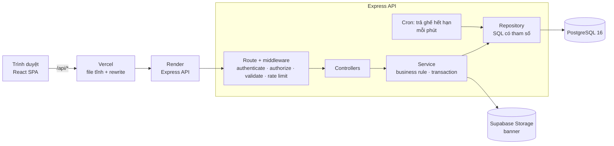
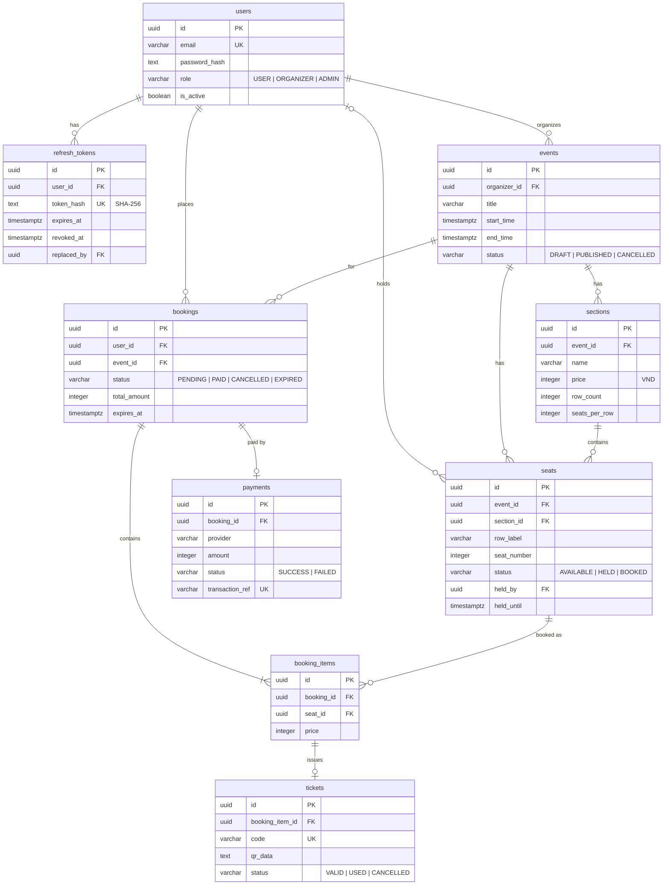

# TicketHub

Nền tảng đặt vé sự kiện: ban tổ chức đăng sự kiện kèm sơ đồ ghế, người dùng giữ ghế, thanh toán và nhận vé QR — được thiết kế để hai người không bao giờ mua trùng một ghế.

[](https://github.com/NHP204/TicketHub/actions/workflows/ci.yml)

**Demo:** TODO-VERCEL-URL · **Tài liệu API:** https://tickethub-api-tjw0.onrender.com/api-docs

> API chạy trên gói miễn phí của Render nên request đầu tiên sau một thời gian không dùng có thể mất đến một phút để server khởi động lại.


## Tài khoản demo

Mọi tài khoản dùng mật khẩu `Password123!`.

| Vai trò   | Email                     | Nên thử                                                                 |
| --------- | ------------------------- | ----------------------------------------------------------------------- |
| User      | `user1@tickethub.dev`     | Chọn ghế, thanh toán trong 10 phút, mở vé QR                            |
| Organizer | `organizer@tickethub.dev` | Tạo sự kiện, thêm khu vực ghế, tải banner, công bố, xem thống kê        |
| Admin     | `admin@tickethub.dev`     | Quản lý người dùng (đổi vai trò, khóa tài khoản), xem thống kê toàn sàn |

Tài khoản thứ hai `user2@tickethub.dev` dùng để thử giành ghế mà `user1` đang giữ.

## Điểm nổi bật

### Chống đặt trùng ghế bằng `SELECT ... FOR UPDATE`

Giữ ghế chạy trong một transaction, khóa các dòng ghế được yêu cầu trước rồi mới kiểm tra:

```sql
SELECT s.*, sec.name, sec.price,
       (s.status = 'AVAILABLE' OR (s.status = 'HELD' AND s.held_until < now())) AS available
FROM seats s
JOIN sections sec ON sec.id = s.section_id
WHERE s.id = ANY($1) AND s.event_id = $2
ORDER BY s.id
FOR UPDATE OF s
```

- Các request cùng một ghế được PostgreSQL xếp hàng: request đầu đánh dấu ghế `HELD`, mọi request sau thấy ghế không còn trống và nhận `409 SEAT_NOT_AVAILABLE`.
- Luôn khóa theo `ORDER BY s.id`, nên hai booking có ghế chồng nhau không thể deadlock.
- Ghế được giữ 10 phút. Cron job trả ghế hết hạn mỗi phút, và ghế giữ đã quá hạn cũng được tính là trống ngay lúc khóa, nên ghế không bao giờ bị kẹt.

`npm run race` bắn 50 request `POST /bookings` cùng lúc vào một ghế trên API đang chạy:

```
50 user cùng giữ ghế <seat-id>:
┌─────────┬─────────────┬──────────────┬──────────┐
│ (index) │ 201 Created │ 409 Conflict │ Lỗi khác │
├─────────┼─────────────┼──────────────┼──────────┤
│ 0       │ 1           │ 49           │ 0        │
└─────────┴─────────────┴──────────────┴──────────┘
ĐÚNG: 1 / 49 / 0
```

Đúng **1** booking được tạo, **49** lỗi xung đột, **0** lỗi khác.

### Refresh token rotation có phát hiện token bị dùng lại

- Access token (JWT 15 phút) chỉ nằm trong bộ nhớ của web, không bao giờ ở `localStorage`.
- Refresh token là cookie `httpOnly` giới hạn ở `/api/v1/auth`; database chỉ lưu SHA-256 hash của nó.
- Mỗi lần gọi `/auth/refresh`, token hiện tại bị thu hồi và token mới được cấp (`replaced_by` nối chuỗi), trong một transaction có khóa dòng token.
- Nếu một token đã được xoay vòng lại bị gửi lên, nó bị coi là bị đánh cắp: **toàn bộ** phiên đăng nhập của user đó bị thu hồi và request thất bại với `TOKEN_REUSED`.
- Web client dùng chung một lần refresh cho các request song song, nên nhiều request hết hạn cùng lúc không gây báo động giả.

### Kiến trúc 3 lớp và dependency injection

- `Route → Middleware → Controller → Service → Repository → PostgreSQL`, không nhảy cóc lớp nào.
- Controller chỉ xử lý HTTP; service chứa business rule và transaction; repository chứa SQL thuần có tham số.
- Mọi hàm repository nhận `db` (pool hoặc client của transaction) làm tham số đầu tiên, nên service ghép chúng trong `withTransaction`.
- `src/container.js` là nơi duy nhất khởi tạo và nối dependency. Unit test truyền repository giả và storage giả vào chính các service đó.

## Công nghệ

| Mảng       | Công cụ                                                                                    |
| ---------- | ------------------------------------------------------------------------------------------ |
| API        | Node.js 22 (ESM), Express 5, node-postgres với SQL thuần, Zod, jsonwebtoken, bcrypt        |
| Dữ liệu    | PostgreSQL 16, node-pg-migrate, node-cron, Supabase Storage (banner sự kiện), qrcode       |
| Bảo mật    | helmet, CORS có credentials, express-rate-limit cho đăng nhập/đăng ký                      |
| Web        | React 19, Vite, React Router, TanStack Query, axios, Tailwind CSS                          |
| Kiểm thử   | `node:test` + supertest (API, PostgreSQL thật), Vitest + Testing Library (web)             |
| Công cụ    | ESLint, oxlint, Prettier, Docker Compose, GitHub Actions                                   |
| Triển khai | Vercel (web, chuyển tiếp `/api/*` sang API), Render (API), Supabase (PostgreSQL + Storage) |

## Kiến trúc



## Cơ sở dữ liệu



Tiền lưu bằng số nguyên đồng (VND); mọi thời điểm là `TIMESTAMPTZ` và trả về dạng ISO 8601.

## Chạy local

Cần có: Node.js 22, Docker Desktop, Git. Trên Windows, chạy các lệnh trong Git Bash.

```bash
git clone https://github.com/NHP204/TicketHub.git
cd TicketHub

# 1. File môi trường (giá trị mẫu dùng được ngay cho local)
cp api/.env.example api/.env
cp api/.env.test.example api/.env.test
cp web/.env.example web/.env

# 2. PostgreSQL cho dev (cổng 5432) và test (cổng 5433)
docker compose up -d db db_test

# 3. API: http://localhost:4000
cd api
npm ci
npm run migrate
npm run seed
npm run dev
```

Ở terminal thứ hai:

```bash
# 4. Web: http://localhost:5173
cd web
npm ci
npm run dev
```

Mở http://localhost:5173 và đăng nhập bằng một [tài khoản demo](#tài-khoản-demo).

Lưu ý:

- Tải banner cần một project Supabase thật: điền `SUPABASE_URL`, `SUPABASE_SERVICE_KEY` và `SUPABASE_BUCKET` trong `api/.env`. Mọi chức năng khác chạy được với giá trị mẫu.
- Muốn chạy API bằng Docker thay cho `npm run dev`, dùng `docker compose up -d --build` (đọc `api/.env` và kết nối tới service `db`). Không chạy cả hai cùng lúc vì cùng dùng cổng 4000.
- Nếu migration báo `password authentication failed for user "tickethub"`, nhiều khả năng một PostgreSQL khác cài trên máy đang chiếm cổng 5432. Tắt nó rồi chạy lại.

## Tài liệu API

Tài liệu OpenAPI tương tác (Swagger UI):

- Local: http://localhost:4000/api-docs
- Production: https://tickethub-api-tjw0.onrender.com/api-docs

Mọi endpoint nằm dưới `/api/v1`. Response có dạng `{ success: true, data, meta? }` hoặc `{ success: false, error: { code, message, details? } }`.

## Kiểm thử

```bash
# API: unit test + integration test trên database test (cổng 5433)
cd api
npm run migrate:test
npm test

# Web
cd web
npm test
```

Race test (cần database dev đã seed và API đang chạy bằng `npm run dev`):

```bash
cd api
npm run race   # kết quả mong đợi: 1 / 49 / 0
```

Script tạo 50 user tạm, gửi request của họ cùng lúc, in kết quả rồi tự dọn dẹp.

CI chạy lint, kiểm tra format và toàn bộ test cho cả `api` lẫn `web` ở mỗi lần push.

## Cấu trúc thư mục

```
TicketHub/
├── api/
│   ├── migrations/          migration SQL (node-pg-migrate)
│   ├── seeds/seed.js        tài khoản demo + một sự kiện mẫu
│   ├── scripts/race-test.js test 50 user đặt cùng một ghế
│   ├── docs/openapi.yaml    đặc tả API
│   ├── src/
│   │   ├── config/          kiểm tra biến môi trường, pool, withTransaction
│   │   ├── modules/         auth, events, sections, bookings, payments, tickets, stats, users
│   │   │                    (routes → controller → service → schemas)
│   │   ├── repositories/    mỗi bảng một file, SQL thuần
│   │   ├── middlewares/     authenticate, authorize, validate, rate limit, upload, lỗi
│   │   ├── jobs/            trả ghế giữ đã hết hạn
│   │   ├── services/        storage (Supabase / bản giả cho test)
│   │   ├── errors/          AppError và các lớp con
│   │   ├── utils/           jwt, password, response, logger
│   │   └── container.js     nối dependency
│   └── test/                unit/ (repo giả) và integration/ (database thật)
├── web/
│   └── src/
│       ├── api/             axios client tự refresh token, mỗi tài nguyên một file
│       ├── pages/           trang user, organizer/ và admin/
│       ├── components/      SeatMap, Countdown, SectionEditor, ...
│       ├── context/         trạng thái đăng nhập (access token trong bộ nhớ)
│       └── hooks/, utils/
├── docker-compose.yml       PostgreSQL dev/test + container API
└── .github/workflows/ci.yml
```

## Hướng phát triển

- Cổng thanh toán thật (VNPay / MoMo) với webhook có chữ ký, thay cho provider giả lập.
- Màn hình check-in cho ban tổ chức: quét mã QR và đánh dấu vé `USED`.
- Gửi vé và nhắc lịch qua email.
- Cập nhật sơ đồ ghế theo thời gian thực bằng WebSocket hoặc Server-Sent Events.
- Test end-to-end (Playwright) cho luồng đặt vé và thanh toán.
